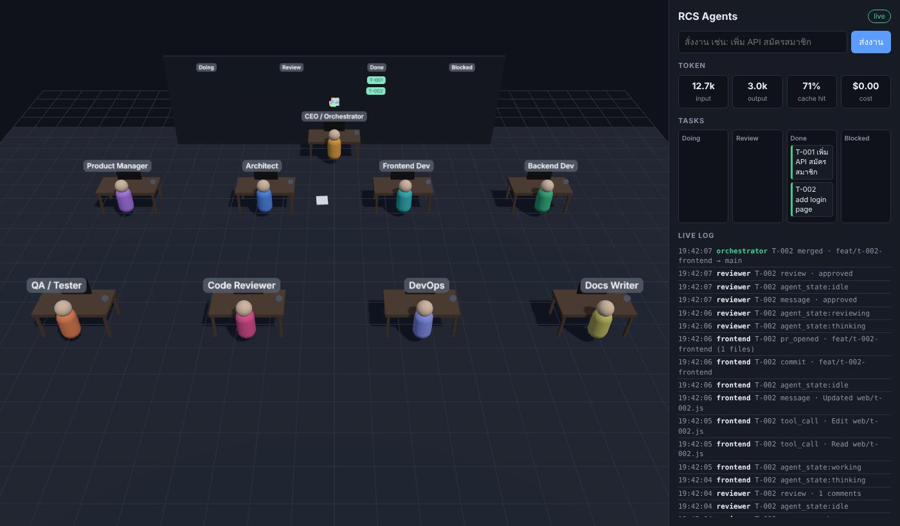

# RCS-Agents

บริษัทพัฒนาซอฟต์แวร์ที่ทำงานโดย AI agent แต่ละแผนกทำงานผ่าน Git (branch, commit, review, merge) และดูการทำงานแบบสดได้ในออฟฟิศ 3D

An AI software company: role-based Claude agents collaborate through Git, and you watch them work live in a 3D office.



## เริ่มใช้งาน

ต้องใช้ Node.js 20 ขึ้นไป

```bash
npm install
npm run demo          # โหมดจำลอง ไม่เรียก Claude ไม่เสีย token
# เปิด http://localhost:4317 แล้วพิมพ์งานในช่อง "สั่งงาน"
```

ใช้งานจริงกับ Claude (ต้องมี `ANTHROPIC_API_KEY` หรือ login Claude Code ไว้แล้ว):

```bash
export ANTHROPIC_API_KEY=sk-ant-...
TEST_CMD="npm test" npm start -- --repo ../my-project --task "เพิ่ม API สมัครสมาชิก"
```

`--repo` คือโปรเจกต์ที่ให้ agent ทำงาน ถ้ายังไม่มีจะสร้าง Git repo ใหม่ให้ (ค่าเริ่มต้น `./workspace`)

## ขั้นตอนการทำงานของงานหนึ่งชิ้น

1. **Orchestrator** (Haiku) แปลงคำสั่งเป็น task card (`tasks/T-001.md`) แล้วเลือกว่าจะส่งให้ Backend หรือ Frontend
2. **Developer** (Sonnet) ทำงานใน `git worktree` ของตัวเองบน branch `feat/t-001-backend`
3. ตัวโปรแกรม commit ให้ และรัน `TEST_CMD` ถ้าเทสต์ไม่ผ่านจะส่ง 40 บรรทัดสุดท้ายของ log กลับไปให้ Dev แก้
4. **Code Reviewer** (Opus) อ่านแค่ task card และ diff แล้วตอบเป็น JSON ว่า approve หรือขอแก้
5. ถ้า approve จะ merge เข้า `main` ถ้าครบ `MAX_ROUNDS` หรือเกิน `TASK_BUDGET_USD` งานจะถูกพักไว้ให้คุณตัดสินใจ

ทุกขั้นตอนจะส่ง event เข้า event bus แล้ว WebSocket ส่งต่อไปที่ออฟฟิศ 3D หน้า UI แค่ฟัง event อย่างเดียว ไม่เรียก Claude จึงเปิดดูได้ตลอดเวลาโดยไม่เสีย token

## วิธีที่ใช้ประหยัด token

| วิธี | อยู่ที่ไฟล์ |
| --- | --- |
| system prompt สั้นและเหมือนเดิมทุกครั้ง ทำให้ prompt cache ใช้ซ้ำได้ | `src/config/roles.ts` |
| ให้แต่ละแผนกใช้เฉพาะ tool ที่จำเป็น Reviewer กับ Orchestrator ไม่มี tool เลย | `src/config/roles.ts` |
| เลือกโมเดลตามงาน: Haiku สำหรับแจกงาน, Sonnet เขียนโค้ด, Opus รีวิว | `src/config/roles.ts` |
| ส่งต่องานด้วย task card และ diff แทนประวัติแชท | `src/orchestrator.ts` |
| ให้ดูแค่รายชื่อไฟล์ ไม่ส่งเนื้อหาไฟล์ทั้งหมด | `src/git.ts` (`fileMap`) |
| งาน git, เทสต์ และ commit ทำด้วยโค้ดธรรมดา ไม่ใช้ LLM | `src/git.ts`, `src/orchestrator.ts` |
| ไม่โหลด settings หรือ CLAUDE.md ของเครื่อง (`settingSources: []`) และจำกัด `maxTurns` | `src/agents/claude.ts` |
| จำกัดจำนวนรอบรีวิวและงบต่องาน | `MAX_ROUNDS`, `TASK_BUDGET_USD` |

## ตั้งค่า (environment variables)

| ตัวแปร | ค่าเริ่มต้น | ความหมาย |
| --- | --- | --- |
| `TARGET_REPO` | `workspace` | โปรเจกต์ที่ให้ agent ทำงาน (หรือใช้ `--repo`) |
| `PORT` | `4317` | พอร์ตของหน้าออฟฟิศ |
| `TEST_CMD` | ไม่มี | คำสั่งเทสต์ที่รันก่อนส่งรีวิว |
| `MAX_ROUNDS` | `3` | จำนวนรอบแก้งานสูงสุด |
| `TASK_BUDGET_USD` | `2` | งบประมาณโดยประมาณต่องาน |
| `MODEL_OPUS` / `MODEL_SONNET` / `MODEL_HAIKU` | `claude-opus-5-5` / `claude-sonnet-5-5` / `claude-haiku-5-5` | เปลี่ยนโมเดลแต่ละระดับ |
| `MOCK_DELAY_MS` | `700` | ความเร็วของโหมดจำลอง |

## โครงสร้างโปรเจกต์

```
src/
  index.ts           จุดเริ่มต้น: เปิด server และรับงานเข้าคิว
  orchestrator.ts    ขั้นตอน task card → dev → test → review → merge
  git.ts             worktree, commit, diff, merge
  events.ts          event bus (มี history ให้คนที่เข้ามาทีหลัง และเก็บ log เป็น JSONL ไว้ replay)
  server.ts          HTTP + WebSocket สำหรับออฟฟิศ 3D
  tasks.ts           task card และ JSON schema ของคำตอบ
  config/roles.ts    8 แผนก: prompt, โมเดล, tool, ขอบเขตไฟล์, ตำแหน่งโต๊ะ
  agents/claude.ts   agent จริงผ่าน Claude Agent SDK
  agents/mock.ts     agent จำลอง ไม่ใช้ token
web/                 ออฟฟิศ 3D (three.js) + kanban + มิเตอร์ token + live log
tests/               เทสต์ทั้งขั้นตอนด้วย agent จำลอง
```

## สิ่งที่จะทำต่อ

- ให้ PM, Architect, QA, DevOps, Docs เข้ามาร่วมในขั้นตอนการทำงาน (ตอนนี้มีโต๊ะในออฟฟิศแล้ว แต่ยังไม่ได้รับงาน)
- รันหลายงานพร้อมกัน และเปลี่ยน event bus เป็น Redis Streams
- เปิด PR บน GitHub จริงแทนการ merge ในเครื่อง พร้อมจุดให้คุณกดอนุมัติจากหน้า UI
- ปุ่ม Pause/Resume และ replay event ย้อนหลัง

## เทสต์

```bash
npm run typecheck
npm test
```
